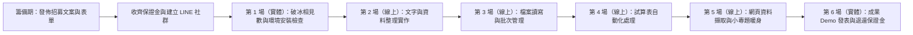

# Python × AI 初學者共學讀書會企劃書（線上＋實體混合季計畫）

這是一份專為 **Python（一種語法簡潔、適合初學者的程式語言）零基礎至入門學員** 打造的讀書會完整落地企劃書。整體採用 **線上與實體混合制**，為期一季（3 個月、共 6 場），結合經典實作書籍與 **AI（Artificial Intelligence，人工智慧）輔助學習與除錯**，協助 6～12 位夥伴透過輪流導讀與動手寫程式，把課堂語法真正轉化為解決生活與工作問題的能力。

---

## 目錄

1. [企劃總覽與辦理目的](#1-企劃總覽與辦理目的)
2. [選書策略與 6 場共讀進度規劃](#2-選書策略與-6-場共讀進度規劃)
3. [單場標準議程與角色分工](#3-單場標準議程與角色分工)
4. [共學工具環境與協作規範](#4-共學工具環境與協作規範)
5. [經費預算、保證金制度與出席公約](#5-經費預算保證金制度與出席公約)
6. [風險評估與常見問題備案](#6-風險評估與常見問題備案)
7. [實用執行附錄（可直接複製套用）](#7-實用執行附錄可直接複製套用)
8. [重點整理](#8-重點整理)

---

## 1. 企劃總覽與辦理目的

### 為什麼要辦這個讀書會？（辦理目的）

許多程式初學者在剛學完基礎語法（例如變數、迴圈與函式）後，常會遇到三個痛點：**「自己看書容易半途而廢」**、**「遇到錯誤訊息不知道怎麼找原因」**，以及**「不曉得學完語法後能做什麼實用工具」**。

因此，本讀書會的設計目的有三個核心方向：

1. **用小班同儕力量克服自學孤單**：維持 6～12 人小班制，讓每位夥伴都有開口提問與分享螢幕的機會，建立互相打氣的學習節奏。
2. **從「背語法」走向「動手做自動化」**：透過共讀實作型書籍與現場寫程式，把 Python 真正用在整理檔案、處理表格等日常任務。
3. **養成正確的 AI 協作學習習慣**：教導初學者把 AI 當成「24 小時程式家教」，學會看懂錯誤訊息並逐步 **Debug（除錯，尋找並修正程式錯誤）**，而不是盲目複製貼上看不懂的程式碼。

### 讀書會基本資料摘要表

| 企劃項目 | 規劃內容 |
| :--- | :--- |
| **讀書會名稱** | Python × AI 初學者實作共學讀書會（第一季） |
| **主題定位** | 程式入門實作 × AI 工具輔助學習與除錯 |
| **目標對象** | 課程同學或 Python 零基礎～入門同好（具備基本電腦操作能力即可） |
| **成員規模** | **6～12 人**（精緻小班制，確保每人都能分享螢幕與被照顧到） |
| **活動期程** | 一季 **3 個月**，每兩週聚會 1 次，共 **6 場**，每次 **2 小時（120 分鐘）** |
| **舉辦形式** | **線上＋實體混合制**：第 1 場（期初破冰）與第 6 場（期末發表）採實體聚會；第 2～5 場採線上視訊共讀 |
| **主推書籍** | 《Python 自動化的樂趣：搞定重複瑣碎&單調無聊的工作》（附備選書單） |
| **費用與機制** | **保證金 500 元**（出席達標且完成輪值任務即全額退還）；實體場地費／餐飲採現場 **AA 制（各自平均分攤費用）** |
| **共學工具** | **LINE 社群**（日常聯絡）＋ **Google Meet**（線上視訊）＋ **HackMD / Notion**（共筆留存） |
| **建議開發環境** | Windows 作業系統 ＋ **VS Code（Visual Studio Code，免費程式碼編輯器）** ＋ Python 3.10 以上版本 |

### 一季運作總流程圖

以下呈現從開團籌備、實體破冰、線上雙週共讀到期末成果發表的完整運作路徑：



---

## 2. 選書策略與 6 場共讀進度規劃

### 為什麼選擇實作型入門書搭配 AI？（選書原則）

對初學者而言，純講理論或語法百科全書型的書籍容易讓人想睡覺；反之，以「生活自動化任務」為主軸的書籍能讓人馬上看到程式跑起來的成就感。本企劃建議採取 **「共讀一本經典實作書 ＋ 每場輪流導讀 ＋ AI 輔助除錯」** 的模式。

#### 候選書籍比較表

主辦人可直接採用主推書籍；若多數報名成員完全未接觸過 Python 基本語法，也可於期初改選下表中的入門基礎書作為暖身替代方案：

| 書籍名稱 | 定位與難度 | 內容特色 | 適用情境建議 |
| :--- | :--- | :--- | :--- |
| **《Python 自動化的樂趣：搞定重複瑣碎&單調無聊的工作》**（主推） | 入門實作（★★☆☆☆） | 前半段快速複習基礎語法，後半段涵蓋檔案批次改名、Excel 處理、PDF 與網頁擷取，案例貼近上班族與學生日常。 | **最適合已學過基本變數、迴圈與函式，想做出實用小工具的班級同學。** |
| **《Python 程式設計：從入門到實戰》**（備選 A） | 零基礎循序（★☆☆☆☆） | 步驟拆解極細，圖解多，每章皆有短練習題，涵蓋串列、字典、函式與基礎物件導向概念。 | 適合「完全沒寫過一行程式」比例超過一半的新手班。 |
| **《AI 時代的 Python 實戰攻略》或同類型工具書**（備選 B） | 工具應用（★★★☆☆） | 聚焦如何用 Python 串接資料處理套件並結合生成式 AI 提升寫程式效率。 | 適合已有半年內程式經驗、想加速整合 AI 工作流的成員。 |

---

### 6 場完整進度總表（共 3 個月／12 週）

以下為以主推書籍《Python 自動化的樂趣》為核心所規劃的雙週進度表（每場 2 小時）：

| 場次 | 建議時間 | 形式 | 本場主題與對應章節 | 現場實作小任務 | 導讀安排 |
| :--- | :--- | :--- | :--- | :--- | :--- |
| **第 1 場** | 第 1 週週末 | **實體聚會** | **期初破冰 × 環境確認 × 書籍導論**<br>（確認 VS Code、Python 3.10+ 與 AI 帳號） | 現場成功執行第一支程式、測試 AI 問答與領取輪值場次 | 總召主持（全員自我介紹） |
| **第 2 場** | 第 3 週 | **線上視訊** | **字串處理與資料清洗**<br>（複習字串方法、正規表達式初探） | 用 Python 檢查並格式化電話號碼或整理雜亂筆記文字 | 輪值導讀人 1～2 位 |
| **第 3 場** | 第 5 週 | **線上視訊** | **檔案與資料夾自動化管理**<br>（`pathlib`／檔案讀寫、批次重新命名） | 寫出「自動分類下載資料夾」或「批次檔名整理預覽」程式 | 輪值導讀人 1～2 位 |
| **第 4 場** | 第 7 週 | **線上視訊** | **Excel 試算表與 CSV 自動化**<br>（讀取報表、條件篩選、自動寫入統計結果） | 將一份模擬記帳或成績 CSV 檔自動算出總和並產生新報表 | 輪值導讀人 1～2 位 |
| **第 5 場** | 第 9 週 | **線上視訊** | **網頁資訊擷取與期末題目確認**<br>（基礎網頁結構觀念、簡單資料抓取與防呆） | 抓取公開靜態網頁標題清單，並確定每人第 6 場的 5 分鐘實作題目 | 輪值導讀人 1～2 位 |
| **第 6 場** | 第 11 週週末 | **實體聚會** | **期末成果 Demo 發表 × 結業頒獎**<br>（Demo：成果展示與現場操作示範） | 每人 5 分鐘展示「自己的自動化小工具」＋ 結算退還保證金 | 每位成員輪流上台分享 |

---

### AI 輔助學習與除錯原則（含實用 Prompt 提示詞範例）

#### 為什麼要規定 AI 使用方式？
如果初學者只對 AI 說「幫我寫一個整理檔案的程式」，雖然能得到答案，但只要環境稍微不同或程式出錯，自己就完全不會修。因此讀書會約定：**「自己先動手 ➔ 貼上報錯讓 AI 當家教 ➔ 理解後再改寫」** 的三步原則：

1. **先跑出結果或錯誤訊息**：自己先照著書本敲一遍程式碼，真的卡住超過 10 分鐘再問 AI。
2. **要求 AI「逐行解釋」而非只給新程式**：把完整程式碼與終端機的紅字錯誤訊息（Traceback，錯誤追蹤紀錄）一起貼給 AI。
3. **驗證與精簡**：在 VS Code 執行確認沒問題後，將「原本錯在哪、怎麼修好」記錄到讀書會共筆的「踩坑區」。

#### 初學者必備 3 個複製即用 Prompt（提示詞，給 AI 的指令）

**1. 卡關除錯專用（請 AI 找出錯誤原因）**
```text
我是 Python 初學者，使用 Windows 和 VS Code。
我在練習以下程式碼時出現了錯誤訊息，請先用白話文告訴我「為什麼會出錯」，再告訴我「修改哪幾行」，不要一次把整段程式重寫成我看不懂的高階語法。

【我的程式碼】
（貼上你的程式碼）

【錯誤訊息】
（貼上終端機顯示的紅字錯誤訊息）
```

**2. 觀念看不懂專用（請 AI 用生活比喻解釋）**
```text
請用「生活化的比喻」向完全沒有程式基礎的人解釋什麼是 Python 的 try / except（例外處理），並給我一個 15 行以內、可以直接在終端機執行的小範例，加上繁體中文註解。
```

**3. 程式碼優化與復盤專用（寫完後請 AI 給建議）**
```text
這是我自己寫出來的 Python 練習程式，目前可以正常執行。請幫我檢查有沒有變數命名不夠清楚、縮排或潛在輸入錯誤的問題，並給我 2 個最適合初學者改進的小建議。

【我的程式碼】
（貼上你的程式碼）
```

---

## 3. 單場標準議程與角色分工

### 120 分鐘單場時間軸（以線上場為標準，實體場微調說明於備註）

為了讓每次 2 小時的聚會既不會只聽導讀人單向念課本，也不會因為討論太久而超時，建議固定採用以下節奏：

| 時段 | 時長 | 活動環節 | 具體進行方式 | 實體場／線上場微調差異 |
| :--- | :--- | :--- | :--- | :--- |
| **00:00 – 00:10** | 10 分鐘 | **報到暖場與上週回顧** | 點名確認出席、檢查共筆連結是否都能開啟、簡短聊聊上週實作有沒有遇到困難。 | 線上場開鏡頭打招呼兼測試麥克風；實體場則領取飲料與連接 Wi-Fi。 |
| **00:10 – 00:40** | 30 分鐘 | **輪值導讀人重點拆解** | 導讀人分享事先寫好的 **Markdown（輕量級標記排版語言）** 共筆，聚焦「本章核心觀念」與「實際執行示範」，不逐字唸書。 | 線上場由導讀人分享螢幕；實體場可接投影機或讓大家同步看同一份共筆頁面。 |
| **00:40 – 01:30** | 50 分鐘 | **AI 輔助現場動手實作** | 導讀人公布 1～2 題本週小任務，全員關麥專心寫 20 分鐘；卡關者隨時舉手分享螢幕，大家一起看報錯並用 AI 除錯。 | 線上場超過 8 人可使用 Google Meet 聊天室貼錯、輪流分享螢幕；實體場可直接坐旁邊互看畫面。 |
| **01:30 – 01:50** | 20 分鐘 | **卡關復盤與心得交流** | 邀請 2～3 位成員展示成品或分享「剛剛卡在哪裡、怎麼修好的」，由筆記手彙整進共筆的踩坑紀錄。 | 全體打開麥克風輕鬆互動，鼓勵給予正面回饋。 |
| **01:50 – 02:00** | 10 分鐘 | **下場預告與任務交接** | 確認下一次導讀人與筆記手名單、預告下次閱讀章節範圍、大合照截圖留念。 | 第 1 場需在此時段完成保證金收齊確認與排班認領。 |

---

### 四大輪值角色分工表

#### 為什麼採用輪值制？
如果永遠只有主辦人一人講課，讀書會很快就會變成「免費補習班」，其他成員也會失去參與感。讓大家輪流擔任不同角色，能讓每位夥伴在「準備講給別人聽」的過程中，把觀念學得最紮實。

| 角色名稱 | 負責人數 | 輪值方式 | 核心任務說明 |
| :--- | :--- | :--- | :--- |
| **總召／主辦人** | 1 名 | 固定（整個季期） | 負責開團招募、建群、追蹤保證金收退、開 Google Meet 會議室、協調代打備案與主持第 1、6 場實體聚會。 |
| **導讀人** | 1～2 名／場 | 輪流認領（每人一季至少 1 次） | 會前 3 天整理章節摘要至共筆、準備 1～2 個小練習題與示範程式碼，並在聚會中帶領 30 分鐘導讀。 |
| **筆記手** | 1 名／場 | 輪流認領 | 聚會中負責記錄大家的討論亮點、整理「常見錯誤與 AI 除錯解法」，會後 48 小時內貼到 LINE 社群通知大家複習。 |
| **時間控管與氣氛組** | 1 名／場 | 輪流或主辦兼任 | 在聊天室提醒各環節剩餘時間（例如「實作還剩 5 分鐘」），並適時破冰發問，避免無人開麥冷場。 |

---

### 現場實作題示範格式（導讀人出題標準與可直接執行範例）

為了幫助第 2～5 場的輪值導讀人知道怎麼出題，以下提供一個「**第 3 場：檔案整理預覽小工具**」的出題範例。此範例刻意設計成**只做文字預覽而不實際更改電腦檔案**，讓初學者在測試時零風險，並包含防呆檢查，複製到 VS Code 即可直接執行：

```python
DEFAULT_PREFIX = "study_note"  # 預設檔名前綴常數


def format_single_filename(raw_name, index, prefix=DEFAULT_PREFIX):
    """
    將雜亂的原始檔名整理為統一格式的檔名（僅作字串預覽，不改動真實檔案）

    參數：
        raw_name (str): 原始檔案名稱，例如 "  week1 note.txt "
        index (int): 檔案順序編號（必須大於 0）
        prefix (str): 統一加上的檔名前綴，預設為 "study_note"

    回傳：
        str: 整理後的標準檔名，例如 "study_note_01_week1_note.txt"
    """
    if not isinstance(index, int) or index <= 0:
        raise ValueError("檔案編號 index 必須是大於 0 的整數。")

    cleaned_name = raw_name.strip().lower()  # 去除前後空白並統一轉為小寫
    cleaned_name = cleaned_name.replace(" ", "_")  # 將空白替換成底線，避免命令列讀取問題
    return f"{prefix}_{index:02d}_{cleaned_name}"


def preview_batch_rename(file_list, prefix=DEFAULT_PREFIX):
    """
    批次預覽多個檔名的整理前後對照結果

    參數：
        file_list (list): 包含多個原始檔名字串的串列
        prefix (str): 統一加上的檔名前綴

    回傳：
        list: 整理後的新檔名串列
    """
    renamed_files = []
    for order, old_name in enumerate(file_list, start=1):
        try:
            new_name = format_single_filename(old_name, order, prefix=prefix)
            renamed_files.append(new_name)
            print(f"[{order:02d}] 原檔名：{old_name!r}  ➔  新檔名：{new_name}")
        except ValueError as error:
            # 捕捉數值不合法的錯誤，確保程式不會中途閃退
            print(f"[{order:02d}] 處理失敗：{error}")
    return renamed_files


if __name__ == "__main__":
    # 模擬初學者資料夾裡常見的雜亂筆記檔名
    sample_files = [
        "  Week1 Note.txt ",
        "Python Loop Practice.py",
        "AI Debug Tips.md",
    ]

    print("=== 讀書會檔名整理預覽開始 ===")
    result_list = preview_batch_rename(sample_files, prefix="py_club")
    print(f"=== 共完成 {len(result_list)} 筆檔名預覽 ===")
```

> **導讀人出題小技巧**：可以先提供上面完整結構，把 `format_single_filename` 裡的其中兩行挖空（例如讓大家練習 `.strip()` 與 `.replace()`），讓成員在 20 分鐘內完成填空並加上自己的新檔名測試！

---

## 4. 共學工具環境與協作規範

### 為什麼選擇這套工具組合？
初學者在學習初期最大的障礙往往是「還沒開始寫程式，光裝一堆協作軟體就想放棄」。因此本企劃採用 **零門檻、台灣使用者最熟悉、且完全免費** 的 4 項工具組合：

| 工具類別 | 推薦工具 | 主要用途 | 初學者操作重點 |
| :--- | :--- | :--- | :--- |
| **日常聯絡** | **LINE 社群**（或 LINE 群組） | 聚會提醒、臨時請假、平時寫作業卡關求救、記事本存重要連結。 | 建議善用 LINE「記事本」置頂共筆總目錄與 Google Meet 固定連結，避免訊息被洗掉。 |
| **線上視訊** | **Google Meet** | 第 2～5 場線上聚會使用，支援瀏覽器免安裝直接進房與分享單一視窗螢幕。 | 分享螢幕時建議選擇「分享整個螢幕」或「VS Code 視窗」，字體放大至 16px 以上方便大家看清楚。 |
| **學習共筆** | **HackMD** 或 **Notion** | 存放每場導讀摘要、實作題目、錯誤解法與 `.py` 程式碼範例。 | **HackMD** 原生支援程式碼區塊排版與匿名協作，最適合貼 Python 程式碼；若大家習慣圖像化介面則可用 **Notion**。 |
| **程式開發** | **VS Code ＋ Python 3.10+** | 撰寫與執行所有課本練習與實作程式碼（依循 Windows 環境設定）。 | 務必於第 1 場實體聚會確認每位成員都能在 VS Code 內順利按下執行鈕（Run Python File）。 |

### 線上聚會與共筆操作 5 步驟

1. **會前 3 天公告**：導讀人將整理好的章節大綱與共筆連結貼入 LINE 社群並標記全體成員，提醒大家先翻過對應章節（即使沒全部看懂也沒關係，帶著問題來即可）。
2. **準時進房測試**：聚會開始前 5 分鐘開啟 Google Meet 會議室，成員進入後先打招呼並確認聲音正常，預備好 VS Code 畫面。
3. **遇錯先貼聊天室／共筆**：實作階段若遇到報錯，先把「錯誤訊息截圖或文字」貼到 Google Meet 聊天室或 HackMD 共筆下方，再舉手請求分享螢幕，能大幅節省大家等待口述的時間。
4. **會後 48 小時整理**：當場筆記手補齊「今日卡關 QA 整理」與「AI 好用提示詞紀錄」，並在共筆上方更新參與名單。
5. **雙週節奏提醒**：總召於下一次聚會前 1 週發送 LINE 投票或提醒，確認導讀人進度與成員出席狀況。

---

## 5. 經費預算、保證金制度與出席公約

### 為什麼要收 500 元保證金？（制度設計目的）

免費的線上讀書會最常發生「報名 12 人、第 1 場來 10 人、第 3 場剩 3 人」的斷崖式流失，這會讓認真準備導讀的夥伴感到挫折。透過 **「達成目標即全額退還」** 的 500 元小額保證金機制，能有效篩選出真正願意投入 3 個月的夥伴，同時不會造成經濟負擔。

### 保證金收退規則明細表

| 項目 | 規則內容說明 |
| :--- | :--- |
| **保證金金額** | 每人新台幣 **500 元整**，於第 1 場實體聚會結束前繳交給總召／財務擔當（可採現金或轉帳）。 |
| **全額退還條件** | 一季 6 場結束時，同時符合以下兩項即可於第 6 場現場全額退還 500 元：<br>1. **出席達 5 場（含）以上**（允許合理請假 1 次）。<br>2. **完成至少 1 次輪值任務**（擔任導讀人或筆記手，若人數較多則依排班完成指定次數）。 |
| **請假與補救機制** | 若因病、加班或臨時要事須請假第 2 次以上，須於會前 24 小時在 LINE 群組告知，並於會後 1 週內在共筆補交「當週章節實作截圖＋100 字心得」，即視同補出席（每季最多補救 1 次）。 |
| **未達標處理方式** | 未達上述條件者，其 500 元保證金不予退還，**全數轉入「第 6 場期末實體聚會公積金」**（用於補貼全體成員場地費、茶點或購買結業小獎品）。 |
| **公開記帳原則** | 建立共用 Google 試算表公開記錄每位成員的繳交狀態、出席紀錄與期末公積金收支明細，確保帳目 100% 透明。 |

### 單季活動收支預估表（以 10 位成員為例）

| 費用類別 | 預估金額 | 支付與分攤方式 | 備註 |
| :--- | :--- | :--- | :--- |
| **成員保證金代管** | 500 元 × 10 人 ＝ 5,000 元 | 由總召專款代管，不與個人帳戶混用 | 期末達標全額退還；未達標餘額轉期末公積金 |
| **第 1 場實體聚會場地／低消** | 約 150～250 元／人 | **現場 AA 制**（各自支付飲料或均攤包廂費） | 建議選擇咖啡廳安靜包廂、圖書館討論室或共同工作空間 |
| **第 2～5 場線上視訊與共筆** | **0 元** | 免費工具（Google Meet ＋ HackMD / Notion） | 單場若未超過 100 人，Google Meet 免費版可支援會議需求（註：免費版多人會議單次上限為 60 分鐘，**滿 55 分鐘可中場休息 5 分鐘並開新連結續接後半場**，或使用具進階權限之主辦帳號） |
| **第 6 場期末成果發表與聚餐** | 約 250～400 元／人 | **現場 AA 制**（若有公積金結餘則優先扣除補貼） | 慶祝結業並現場發還保證金 |
| **教材書籍費** | 依個人購買通路約 400～550 元／本 | 成員自行購買紙本或電子書，亦可向圖書館借閱 | 不強制統一團購，若大家有意願團購再另開統計 |

> [!TIP]
> **Google Meet 免費版 60 分鐘限制小提醒**：若總召與成員皆使用一般免費個人 Google 帳號，3 人以上會議單次最長為 60 分鐘。建議直接把第 2～5 場設計成「**上半場 55 分鐘（暖場＋導讀＋實作起手）➔ 休息 5 分鐘喝水上廁所 ➔ 下半場 60 分鐘（點擊第二組預先建好的連結，繼續實作除錯＋復盤）**」，反而更能讓大腦休息！

### 讀書會友善公約

1. **零嘲笑提問原則**：沒有「太笨的問題」，只有還沒搞懂的觀念；任何人在問基礎語法時都應獲得耐心回應。
2. **先試再問不當伸手黨**：發問時請附上「自己試過什麼寫法」與「完整的錯誤畫面」，讓幫助你的人能快速對焦。
3. **準時開始與互相體諒**：輪值導讀人花時間備課很辛苦，請盡量準時上線並給予口頭或文字鼓勵。

---

## 6. 風險評估與常見問題備案

在 3 個月的運作期間，以下列出 6 個最常發生的狀況與事前準備好的應對方案：

| 潛在風險情境 | 發生徵兆／影響 | 事前預防與現場備案 |
| :--- | :--- | :--- |
| **1. 輪值導讀人臨時生病或加班** | 聚會前 1～2 天突然無法出席，導致當週開天窗。 | 1. 每場安排 **1 名主導讀＋1 名副導讀（或備位支援）**。<br>2. 若兩位皆無法上場，立即改為「自由實作＋AI 除錯診斷夜」，由總召帶領大家複習前兩週未寫完的練習題。 |
| **2. 成員程度落差太大** | 寫得快的同學 10 分鐘就寫完開始滑手機；零基礎同學光縮排就卡 30 分鐘。 | 實作題採用 **「基礎必做題 ＋ 進階挑戰題」** 雙軌制。先寫完的夥伴可挑戰進階加分題，或自願擔任小助教協助還在卡關的夥伴。 |
| **3. 線上聚會冷場、沒人開麥克風** | 導讀人問「大家有沒有問題？」後全場安靜 30 秒。 | 1. 規定「氣氛組」必須隨時準備 1 個提問拋磚引玉。<br>2. 改用具體提問法，例如：「請大家在聊天室打 `+1` 代表程式跑出來了，打 `卡關` 我就點你分享螢幕！」 |
| **4. Windows 環境或套件安裝卡關** | 第 2 場要教檔案或 Excel 套件時，有人一直出現 `pip` 安裝失敗。 | 1. **務必在第 1 場實體聚會就完成所有人的 Python 與 VS Code 環境檢查**。<br>2. 若仍有突發環境問題，暫時先請該成員使用瀏覽器免費環境（如 Google Colab）跟上語法邏輯，會後再另約 15 分鐘協助本機排除。 |
| **5. 報名人數不足（低於 6 人）或超額（超過 12 人）** | 人太少輪值壓力大；人太多在 2 小時內無法照顧每位除錯需求。 | 1. **低於 4 人**：改為 4 人精實小隊，週期縮短為雙週輪讀，減少總召負擔。<br>2. **超過 12 人**：嚴守 12 人上限，多餘報名者列為候補或直接拆成 A、B 兩組（實作時分兩間 Meet 討論室）。 |
| **6. 第 4～5 場中後期出席率下降** | 遇到工作忙碌期或書籍後段難度提高，開始有人連續請假。 | 第 4 場前總召主動在群組做一次「期中小調查」，若大家覺得某章太難，彈性將進度放慢半步，並強調「第 6 場期末小工具不用做很大，只要能跑出結果就算成功！」。 |

---

## 7. 實用執行附錄（可直接複製套用）

### 附錄 A：LINE／社團招募文案範本

可直接複製以下文字，替換括號內的日期與連結後發佈至班級群組或學習社群：

```text
【招募共學夥伴】Python × AI 初學者實作讀書會（第一季・限額 6～12 人）🚀

你是不是也常覺得：
😅 課堂聽完語法很清楚，自己打開 VS Code 卻不知道怎麼開始？
🐛 程式跑出紅字錯誤訊息，看半天找不到哪裡少了一個冒號？
📚 想把 Python 拿來做生活小工具，但一個人自學好容易半途而廢？

我們要開一個「新手友善、動手寫為主」的讀書會啦！
不考艱深理論，我們一起共讀《Python 自動化的樂趣》，並練習怎麼把 AI 當成隨身程式家教來除錯！

📌 讀書會重點資訊：
- 進行期間：【填寫起訖月份，例：12 月～隔年 2 月】（共 3 個月／每兩週 1 場／總計 6 場）
- 聚會時間：【填寫固定時段，例：隔週六 14:00～16:00】
- 進行形式：線上＋實體混合（第 1 場破冰與第 6 場成果發表為實體，中間 4 場為 Google Meet 線上共讀）
- 參與資格：Python 初學者或對自動化有興趣的同學皆可，自備 Windows 筆電與一顆敢問問題的心
- 費用機制：預收保證金 500 元（出席達 5 場＋完成 1 次輪值導讀或筆記，期末全額退還！）；實體聚會餐飲或場地費採現場 AA 制

👉 報名表單請點這裡：【貼上 Google 表單連結】
⏰ 報名截止時間：【填寫截止日期】

名額滿 12 人即收單，歡迎有興趣的同學一起來組隊打怪！有任何問題都可以直接留言或私訊【總召聯絡方式】。
```

---

### 附錄 B：Google 表單報名欄位設計清單

建議總召建立 Google 表單收集以下 8 個欄位，方便篩選合適人數並規劃第 1 場分組：

| 欄位順序 | 欄位名稱 | 題型建議 | 是否必填 | 設計目的 |
| :--- | :--- | :--- | :--- | :--- |
| 1 | 姓名／常用暱稱 | 簡答 | 必填 | 製作簽到表與排班表使用。 |
| 2 | LINE 顯示名稱 | 簡答 | 必填 | 方便確認入群身分與核對保證金匯款。 |
| 3 | 目前 Python 學習程度 | 單選題 | 必填 | 選項：`完全零基礎` / `剛學過基礎語法（變數、迴圈、函式）` / `寫過一些小程式`，用於判斷選書是否需微調。 |
| 4 | 電腦環境確認 | 核取方塊 | 必填 | 選項：`Windows 電腦` / `Mac 電腦` / `已安裝 VS Code` / `已安裝 Python 3.10+` / `需要第 1 場協助安裝`。 |
| 5 | 偏好的聚會時段（可複選） | 核取方塊 | 必填 | 列出 3～4 個候選時段（如週三晚間、週六下午、週日下午）統計最大公約數。 |
| 6 | 參加這次讀書會最想完成什麼小目標？ | 段落 | 必填 | 確認動機，也能在期末幫大家回顧初心。 |
| 7 | 同意「500 元保證金收退規則與輪值共學公約」 | 單選確認 | 必填 | 先建立共識，避免事後對規則產生認知落差。 |
| 8 | 實體聚會偏好地區／其他備註 | 簡答 | 選填 | 了解大家交通方便的區域（如火車站周邊或學校附近）。 |

---

### 附錄 C：HackMD／Notion 單場導讀共筆模板

每場聚會前，導讀人與筆記手可直接複製以下 Markdown 模板建立該場次筆記：

```markdown
# 第【X】場共筆｜【填寫章節與主題名稱】

- **日期與時間**：YYYY/MM/DD（週 X）HH:MM – HH:MM
- **聚會形式**：線上（Google Meet） / 實體（地點）
- **本場輪值**：導讀人【姓名】｜筆記手【姓名】｜時間控管【姓名】
- **出席成員**：

---

## 一、本章核心觀念摘要（導讀人會前填寫）

1. **這章要解決什麼生活問題？**
   - 
2. **3 個必記關鍵語法或套件功能**
   - 語法／功能 1：
   - 語法／功能 2：
   - 語法／功能 3：

---

## 二、現場實作挑戰題（50 分鐘練習）

- **題目說明**：
- **預期執行結果**：
- **進階挑戰（寫太快的夥伴可試試）**：

---

## 三、今日踩坑與 AI 除錯紀錄（筆記手彙整）

| 遇到的錯誤訊息 / 問題 | 造成原因白話解釋 | 解決方法（或有效的 AI Prompt） |
| :--- | :--- | :--- |
| 例如：`IndentationError` | 縮排空格數不一致（混用 Tab 與空格） | 在 VS Code 統一設定使用 4 個空格縮排 |
|  |  |  |

---

## 四、下週預告與待辦事項

- **下場日期**：YYYY/MM/DD
- **下場範圍**：第【X】章
- **下場導讀人 / 筆記手**：【姓名】 / 【姓名】
```

---

### 附錄 D：開團前 2 週籌備檢核清單（Checklist，待辦檢核清單）

總召可依照以下時間軸逐項打勾確認，確保開團萬無一失：

- **開團前 14 天（招募啟動）**
  - [ ] 確定讀書會固定時間表（暫定 6 場日期）與保證金收退辦法
  - [ ] 建立 Google 報名表單與共用出席記帳試算表
  - [ ] 貼出招募文案並設定報名截止日
- **開團前 7 天（成團與建群）**
  - [ ] 確認最終成員名單（6～12 人），寄出錄取通知與第 1 場行前說明
  - [ ] 建立 LINE 社群，並在「記事本」置頂放好共筆總目錄連結
  - [ ] 預約第 1 場實體聚會場地（確認電源插座數量與網路穩定度）
- **開團前 3 天（第 1 場準備）**
  - [ ] 準備第 1 場實體簡報或流程清單（含 VS Code ＋ Python 3.10+ 安裝指引）
  - [ ] 建立全季 6 場的輪值排班表（讓大家第 1 場現場直接填寫認領）
  - [ ] 提醒成員攜帶筆記型電腦、充電器、500 元保證金與實體場 AA 費用
- **第 1 場當天（正式開跑）**
  - [ ] 確認所有成員電腦都能順利執行第一支 Python 測試程式
  - [ ] 收齊保證金並當場在公開試算表登錄打勾
  - [ ] 拍一張大合照留念，並確認第 2 場線上輪值導讀人開始備課！

---

## 8. 重點整理

1. **小班高互動是關鍵**：控制在 **6～12 人**，並用「期初實體破冰＋中間線上實作＋期末實體 Demo」的混合節奏，兼顧凝聚力與出席便利性。
2. **先做再用 AI 解釋**：把 AI 定位成「解釋錯誤與觀念的家教」，養成自己先寫、看懂報錯再問 AI 的好習慣，才能真正累積寫程式的能力。
3. **輪值制＋保證金雙保險**：透過 **500 元全額可退還保證金** 維持 3 個月參與率，再用 **導讀人與筆記手輪值制** 讓每位學員都有輸出與成長的機會。
4. **工具極簡化**：採用 **LINE 社群 ＋ Google Meet ＋ HackMD / Notion ＋ VS Code**，讓初學者把時間花在寫 Python，而不是花在研究複雜的協作平台。
5. **直接套用附錄馬上開團**：利用附錄提供的招募文案、報名表單欄位、共筆模板與 2 週檢核清單，今天就能著手發起第一季讀書會。
