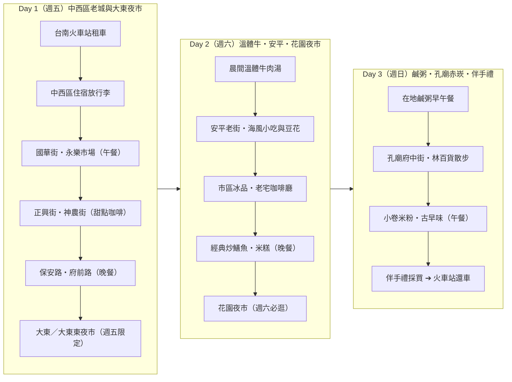

# 台南三天兩夜美食之旅完全指南（週五～週日騎車版）

這是一份專為**週五至週日**出發、採用**租機車／電動車**移動，並集結**經典小吃、特色甜點／老宅咖啡廳、在地夜市與宵夜**所規劃的台南三天兩夜美食攻略。

---

## 目錄

1. [行程總覽與騎車動線圖](#1-行程總覽與騎車動線圖)
2. [行前準備與騎車攻略](#2-行前準備與騎車攻略)
3. [Day 1（週五）：老城經典掃街 × 老宅咖啡 × 大東夜市](#3-day-1週五老城經典掃街--老宅咖啡--大東夜市)
4. [Day 2（週六）：晨間溫體牛肉湯 × 安平海風甜品 × 花園夜市](#4-day-2週六晨間溫體牛肉湯--安平海風甜品--花園夜市)
5. [Day 3（週日）：在地鹹粥早午餐 × 孔廟赤崁甜點 × 伴手禮返程](#5-day-3週日在地鹹粥早午餐--孔廟赤崁甜點--伴手禮返程)
6. [台南夜市營業時間速查表（「大大武花大武花」口訣）](#6-台南夜市營業時間速查表大大武花大武花口訣)
7. [三天兩夜單人花費預算估算表](#7-三天兩夜單人花費預算估算表)
8. [台南必買伴手禮總表](#8-台南必買伴手禮總表)
9. [重點整理與台南吃貨實用貼士](#9-重點整理與台南吃貨實用貼士)

---

## 1. 行程總覽與騎車動線圖

### 行程設定摘要

| 項目 | 規劃內容 |
| :--- | :--- |
| **旅遊天數** | 三天兩夜（週五中午抵達 ➔ 週日下午返程） |
| **交通方式** | 租機車／共享電動車（市區巷弄與安平往返最機靈便利） |
| **建議住宿區** | **中西區**（火車站前、赤崁樓或海安路周邊，騎車至各美食點多在 5～15 分鐘內） |
| **美食主軸** | 經典排隊小吃、溫體牛肉湯、老宅咖啡與冰品、週五大東夜市、週六花園夜市 |
| **飲食忌口** | 無忌口（完整涵蓋牛肉、內臟、海鮮與各式傳統甜品） |

### 三天兩夜騎車動線圖

---

## 2. 行前準備與騎車攻略

### 租車與共享運具建議

1. **火車站前傳統租車行**
   - 台南火車站前站出口（成功路、北門路一帶）車行密集，選擇多且多半提供**免費寄放行李**服務（若有需求可先確認）。
   - 取車時務必攜帶**普通重型機車駕照正本與身分證**，並在騎乘前繞車一圈錄影或拍照存證（含車身刮痕、輪胎紋、油表）。
2. **共享電動機車（GoShare / iRent）**
   - 若不想一次租滿三天，市區內 GoShare 與 iRent 站點密集，短程接駁相當方便。
   - 需注意**週末熱門時段**（如國華街、花園夜市散場時）車輛可能較搶手，且騎去安平前要先確認電量或沿途換電站位置。

### 台南市區騎車與停車注意事項

- **圓環規則（如民生綠園圓環／湯德章紀念公園）**：台南圓環多且車流交織，**請依號誌與地上標線行駛**，部分路口禁止直接左轉或須兩段式待轉，切勿憑感覺切進內線。
- **單行道密集**：中西區（如正興街周邊、神農街周邊小巷）有許多單行道與徒步區，導航時建議開啟「機車模式」，並留意巷口禁行標誌。
- **停車禮儀**：國華街、保安路假日時人車極多，**勿隨意併排或停在紅線、店家門口**；建議停在海安路地下停車場周邊機車格、民族路或府前路合法停車格後，再步行進入掃街。

### 行前必備物品清單

- [ ] **證件**：身分證、普通重型機車駕照（租車必備）
- [ ] **現金與零錢**：台南許多老字號小吃、夜市攤販**僅收現金**，建議多準備百元鈔與 50 元、10 元硬幣
- [ ] **防曬與防蚊**：太陽眼鏡、薄外套、防曬乳、防蚊液（傍晚逛安平與老街巷弄很實用）
- [ ] **個人藥品**：腸胃藥、消食片（三天高密度吃喝必備）、OK 繃
- [ ] **電子與保鮮裝備**：行動電源、充電線、**折疊保冷袋**（若要買布丁、現烤蛋糕或滷味回程很方便）

---

## 3. Day 1（週五）：老城經典掃街 × 老宅咖啡 × 大東夜市

週五中午抵達後先把行李安頓好，下午專攻「中西區徒步吃喝圈」，晚上騎車往東區逛**週五營業的大東／大東東夜市**，動線集中又好停車。

### Day 1 時間軸總覽

| 時段 | 區域 | 主題活動 | 推薦停留時間 |
| :--- | :--- | :--- | :--- |
| **12:00 – 12:45** | 火車站 ➔ 中西區 | 取車、寄放行李或辦理入住 | 45 分鐘 |
| **12:45 – 14:30** | 國華街・永樂市場 | 經典小吃第一輪掃街 | 1.5～2 小時 |
| **14:30 – 17:30** | 正興街・神農街 | 霜淇淋、老宅咖啡廳吹冷氣休息 | 3 小時 |
| **17:30 – 19:30** | 保安路・府前路 | 蝦仁飯、魚羹、豬心冬粉（晚餐） | 2 小時 |
| **19:30 – 22:00** | 東區林森路 | **大東夜市／大東東夜市**巡禮 | 2.5 小時 |
| **22:00 以後** | 海安路・民族路 | 宵夜續攤（視胃容量彈性安排） | 彈性 |

### 各餐期美食詳細清單（首選＋備案）

#### 午餐：國華街・永樂市場掃街
- **首選組合**：
  1. **富盛號碗粿**（或同區的 **一味品碗粿**）：Q 彈米漿搭配肉燥、火燒蝦與鹹蛋黃，淋上蒜泥與甜醬油膏，配一碗魚羹剛好開胃。
  2. **金得春捲**：高麗菜、皇帝豆、蛋皮、蝦仁、肉絲包入微煎春捲皮，可依喜好客製甜度（建議微糖或半糖）。
  3. **阿松割包**：招牌「豬舌包」搭配花生醬與酸菜，口感爽脆不油膩，還附一碗清甜高湯。
  4. **修安扁擔豆花**：手工綿密豆花加上特製黑糖粉粿，當作午餐收尾剛剛好。
- **備案選擇**：若遇富盛號大排長龍，可直接轉往旁邊的 **永樂燒肉飯** 或往國華街二段吃 **阿鳳浮水虱目魚羹**。

#### 下午茶與老宅咖啡：正興街・神農街
- **首選甜點**：**蜷尾家甘味處**（正興街）：台南散步甜食代表，每天限定口味不同（如鐵觀音、抹茶、芝麻或季節水果），先抽號碼牌再去逛旁邊小店。
- **首選老宅咖啡**：
  - **Paripari apt.**（忠義路二段巷內）：昭和復古風格老宅，二樓是咖啡廳，推薦「昭和布丁」與手沖咖啡，環境非常適合拍照放空。
  - **秘氏咖啡**（永樂市場二樓）：隱藏在傳統市場二樓的港式復古空間，手沖咖啡與點心很有特色。
- **備案選擇**：**島入冰店**（赤崁東街巷弄日式刨冰）或 **Kokoni Kakigori**（中西區老宅刨冰）。

#### 晚餐：保安路・府前路經典老味
- **首選組合**：
  1. **矮仔成蝦仁飯**（海安路一段）：拌入柴魚高湯炒香的米飯配上火燒蝦，必加點一顆**半熟鴨蛋**拌飯。
  2. **阿明豬心冬粉**（保安路）：現點現燙的豬心脆口鮮嫩、蒜頭豬腳必點（注意開門前 20 分鐘排隊較不用等太久）。
- **備案選擇**：
  - **集品蝦仁飯**（同樣在海安路一段，風格相近、座位較寬敞）。
  - **保安路米糕**、**醇涎坊古早味鍋燒意麵**（出餐快、在地人日常最愛）。

#### 夜間重頭戲：大東夜市／大東東夜市（週五限定）
> **小提醒**：目前同場地相鄰分為「大東夜市」與「大東東夜市」，營業時間皆為週一、二、五，兩區相通可一次逛完！
- **必吃推薦**：
  - **二師兄古早味滷味**：現場現滷，三杯米血、雞爪、豆干入味不死鹹。
  - **延記臭豆腐**：外酥內嫩、泡菜爽口。
  - **小上海香酥雞**、**古早味地瓜球**、**木瓜牛奶／紅茶牛奶**。
- **備案（宵夜續攤）**：
  - **海安路露天燒烤一條街**：適合三五好友喝茶聊天吹晚風。
  - **一點刈包**（小東路）：營業至深夜，蛋餅與刈包配豆漿是在地經典夜貓餐。

---

## 4. Day 2（週六）：晨間溫體牛肉湯 × 安平海風甜品 × 花園夜市

週六的關鍵字是「**早起喝牛肉湯**」與「**提早進場逛花園夜市**」。上午先喝完鮮甜溫體牛，順路騎車跨區到安平散步吃海鮮點心，下午回市區吹冷氣吃冰，傍晚 17:30 左右直奔花園夜市避開最恐怖的人潮尖峰。

### Day 2 時間軸總覽

| 時段 | 區域 | 主題活動 | 推薦停留時間 |
| :--- | :--- | :--- | :--- |
| **07:30 – 09:00** | 市區／安平 | 晨間現沖溫體牛肉湯（早餐） | 1.5 小時 |
| **09:30 – 13:00** | 安平區 | 安平老街、樹屋散步＋海風小吃與豆花 | 3.5 小時 |
| **13:30 – 16:30** | 中西區 | 老宅咖啡廳或復古冰店（避暑回血） | 3 小時 |
| **16:30 – 17:30** | 赤崁・民族路 | 炒鱔魚意麵、米糕（提前墊胃晚餐） | 1 小時 |
| **17:30 – 20:30** | 北區海安路三段 | **花園夜市**（週六必逛，趁早開吃） | 3 小時 |
| **21:30 以後** | 府前路 | 宵夜備案（豆奶宗沙茶蛋餅） | 彈性 |

### 各餐期美食詳細清單（首選＋備案）

#### 早餐：晨間溫體牛肉湯
- **首選 A（若要直接順路逛安平）**：**文章牛肉湯（安平總店）**
  - 離安平老街近、座位數多、品項齊全（招牌牛肉湯＋牛肉燥飯／豬油拌飯），**建議 08:00 前抵達**，避開 10:00 後的觀光團人潮。
- **首選 B（若想挑戰清晨極致派）**：**六千泓佐土產牛肉**（海安路）或 **西羅殿牛肉湯**（公園南路）
  - 六千以第一鍋牛骨高湯著稱（需清晨 04:30～05:00 領號碼牌）；西羅殿醬料與牛肉燥飯也很受歡迎，建議 07:30 前到。
- **備案選擇**：**阿財牛肉湯（安平）**、**康樂街牛肉湯**（高湯走蔬果清甜路線，不加味精）。

#### 上午至中午：安平區騎車漫遊
- **鹹食小吃**：
  - **王氏魚皮**：煎魚肚外皮金黃焦香、魚皮湯清爽鮮美，是在地人從早吃到午的愛店。
  - **備案**：**周氏蝦捲**（現炸蝦捲外酥內多汁，冷氣座位舒適）。
- **安平甜品與伴手禮**：
  - **同記安平豆花（總店）**：傳統白豆花配紅豆或珍珠，加檸檬汁更清爽解膩。
  - **伊蕾特布丁**：安平總店可買單顆現場吃，也能先預訂回程再帶（或直接用宅配）。
- **順遊景點**：安平樹屋、德記洋行、安平古堡外圍老街（延平街）、漁光島（若想看海吹風可多留 40 分鐘）。

#### 下午茶與冰品：市區老宅甜點／冰店
- **首選冰品**：**太陽牌冰品**（民權路一段）：必點「紅豆牛奶霜」與方形古早味草湖芋仔冰，濃郁奶香是台南人的共同記憶。
- **備案冰品**：**莉莉水果店**（府前路一段孔廟旁）：新鮮現切水果盤、番茄切盤（附薑汁醬油膏是南部特色！）與木瓜牛奶。
- **首選老宅咖啡**：**StableNice BLDG.**（南寧街）：結合藝廊與質感咖啡的老屋空間，甜點與飲品水準穩定，很適合下午躲太陽休息。
- **備案咖啡**：**兜空間 Dou Maison** 或 **鳥飛古物店**周邊巷弄咖啡館。

#### 晚餐（前哨戰）：台南經典老味
> **吃貨策略**：為了保留戰力給花園夜市，這餐建議 **2～3 人合點一盤炒鱔魚＋一碗米糕**就好！
- **首選**：**阿江炒鱔魚**（民族路三段，17:00 開賣）或 **進福炒鱔魚專家**（府前路）
  - 大火快炒的鍋氣十足，帶出台南特有的酸甜焦香，乾炒意麵口感最脆口。
- **搭配小點**：**落成米糕**（民族路二段）：粒粒分明的糯米淋上肉燥、魚鬆與小黃瓜片，配四神湯很剛好。

#### 夜間重頭戲：花園夜市（週六必逛）
> **排隊避坑秘訣**：週六花園夜市在 19:00 後常擠到水泄不通，建議 **17:30～18:00 就先騎車進場停好車**，此時多數攤位剛準備好、排隊人潮最少！
- **必吃推薦**：
  - **統大炭烤香雞排**：先炸後烤刷上獨門甜鹹醬汁，外皮微酥帶炭香。
  - **阿美芭樂**：脆甜芭樂與各種醃漬水果，逛夜市必備解膩神物。
  - **紅妃香腸大腸**：九層塔、洋蔥配香腸大腸一起炒，香氣超濃。
  - **麻糬叔叔**：現包多口味手工麻糬，適合當夜市最後的甜品。
- **週六備選夜市**：如果覺得花園夜市人太多，週六也可以改去**武聖夜市**（台南歷史最悠久的夜市，動線較寬敞，推薦阿堯師雞蛋糕、三輪車大腸香腸）。
- **宵夜備案**：**豆奶宗**（府前路二段，21:40 營業至清晨）：宵夜必吃「沙茶蛋餅＋鮮奶茶」或火腿蛋吐司。

---

## 5. Day 3（週日）：在地鹹粥早午餐 × 孔廟赤崁甜點 × 伴手禮返程

週日節奏放慢，早上用一碗澎湃的**台南虱目魚鹹粥**開啟一天，上午在孔廟與林百貨一帶散步買伴手禮，中午以經典**小卷米粉**收尾，下午輕鬆還車搭車返家。

### Day 3 時間軸總覽

| 時段 | 區域 | 主題活動 | 推薦停留時間 |
| :--- | :--- | :--- | :--- |
| **08:30 – 10:00** | 中西區／北區 | 台南經典鹹粥早午餐 | 1.5 小時 |
| **10:00 – 12:30** | 孔廟・府中街・林百貨 | 老宅散步、吃點心、逛文創百貨 | 2.5 小時 |
| **12:30 – 14:00** | 國華街三段／赤崁 | 小卷米粉或經典古早味（壓軸午餐） | 1.5 小時 |
| **14:00 – 16:00** | 市區各點 ➔ 火車站 | 採買伴手禮、領行李、還車返程 | 2 小時 |

### 各餐期美食詳細清單（首選＋備案）

#### 早餐：台南經典鹹粥
- **首選 A（在地高人氣、CP 值高）**：**大勇街無名鹹粥**（中西區大勇街）
  - 湯頭鮮甜清爽，料多實在，搭配一根酥脆油條沾湯吃最道地（注意開門早、賣完會提早收攤，建議 09:00 前到）。
- **首選 B（老字號經典）**：**阿憨鹹粥**（北區公園南路）或 **阿堂鹹粥**（西門路一段）
  - 魚骨熬煮高湯加上整片無刺虱目魚肚、鮮蚵，份量十足。
- **備案選擇**：**悅津鹹粥**（西門圓環邊，24 小時營業，完全不用怕賣完撲空）。

#### 上午慢遊與點心：孔廟・府中街・林百貨
- **散步小點**：
  - **克林台包**（府前路一段，孔廟斜對面）：招牌「八寶肉包」餡料豐富（有香菇、蛋黃、肉塊），也有甜口味芋頭包、麻辣臭包子可買。
  - **府中街（孔廟商圈）**：綠蔭步道適合飯後散步，沿路有古早味烤黑輪、椪糖 DIY 等小攤。
- **老宅咖啡與甜點**：
  - **窄門咖啡**（南門路）：須穿過僅 38 公分的經典窄巷上二樓，老屋木窗俯瞰孔廟綠意很有味道。
  - **鷲嶺食肆**（忠義路二段鶯料理原址旁）：百年日式木造建築改建，可點一壺茶配和菓子或甜點靜靜休息。
- **順遊採買**：**林百貨**（忠義路二段）：台灣現存最古老的百貨之一，頂樓有神社遺跡，各樓層集結台南精選文創與伴手禮，一次買齊很方便。

#### 壓軸午餐：小卷米粉／古早味
- **首選**：**葉家小卷米粉**（國華街二段）或 **邱家小卷米粉**（國華街三段）
  - 兩家皆主打每日新鮮小卷配粗米粉，湯頭清甜爽口、完全不油膩，非常適合作為三天大魚大肉後的清爽壓軸。
- **備案選擇**：
  - **赤崁棺材板**（沙卡里巴市場內老店）或 **度小月擔仔麵**（中正路）。
  - **再發號百年肉粽**（民權路二段）：若想吃點飽足感更強的傳統米食，特製八寶肉粽也是百年名店。

#### 伴手禮採買與火車站還車
- 若伴手禮有**布丁、蛋糕或需要冷藏**的品項，建議安排在 Day 3 下午最後 1.5 小時統一領取或購買，直接裝進保冷袋騎回火車站前還車，讓鮮度維持到回家！

---

## 6. 台南夜市營業時間速查表（「大大武花大武花」口訣）

台南最經典的夜市口訣是「**大大武花大武花**」，代表週一到週日每天晚上有哪些大型流動夜市營業：

| 星期 | 對應口訣 | 營業夜市 | 交通與逛街特色 |
| :--- | :--- | :--- | :--- |
| **週一** | **大** | **大東夜市／大東東夜市** | 位於東區林森路，美食攤位集中、好停車 |
| **週二** | **大** | **大東夜市／大東東夜市** | 同週一，平日人潮相對週末少 |
| **週三** | **武** | **武聖夜市** | 位於中西區，台南歷史最久、在地人最常逛 |
| **週四** | **花** | **花園夜市** | 位於北區，規模最大、攤位數最多（週四較不擠） |
| **週五** | **大** | **大東夜市／大東東夜市** | **【本行程 Day 1 安排】** 週末前夕氣氛熱鬧 |
| **週六** | **武花** | **花園夜市**、**武聖夜市** | **【本行程 Day 2 安排】** 雙夜市齊開，花園最盛大、武聖較不擠 |
| **週日** | **花** | **花園夜市** | 週日收假夜人潮略少於週六，也很適合逛 |

> **小提醒**：以上流動夜市大多在 **17:30～18:00 陸續擺攤、營業至 23:30～00:00**；出發前建議再次查看各夜市官方粉專或 Google Maps，確認是否因雨天或特殊節日休市。

---

## 7. 三天兩夜單人花費預算估算表

以下以**單人**（含兩人分攤雙人房住宿與機車租借，或單人獨立負擔估算）整理兩種花費區間，方便依需求抓預算（不含出發地往返台南之高鐵／台鐵車票）：

| 費用項目 | 小資精省版（台幣） | 舒適享受版（台幣） | 備註說明 |
| :--- | :--- | :--- | :--- |
| **租機車＋油資（3 天）** | 約 600 – 900 元 | 約 900 – 1,400 元 | 125cc 機車約 350～450 元／天，兩人分攤更省 |
| **住宿費（2 晚）** | 約 1,800 – 2,600 元 | 約 3,500 – 5,500 元 | 週五與週六晚間，中西區青旅／民宿／設計旅店 |
| **經典小吃與正餐** | 約 1,200 – 1,600 元 | 約 1,800 – 2,500 元 | 牛肉湯、鹹粥、蝦仁飯、鱔魚意麵與夜市吃喝 |
| **甜點、冰品與老宅咖啡** | 約 500 – 800 元 | 約 900 – 1,400 元 | 霜淇淋、豆花、刨冰、每天一間咖啡廳 |
| **伴手禮採買** | 約 500 – 800 元 | 約 1,000 – 2,000 元 | 依個人購買盒數與品項彈性增減 |
| **總計（不含跨縣市車票）** | **約 4,600 – 6,700 元** | **約 8,100 – 12,800 元** | 若兩人以上同行分食小吃與分攤房費會更划算 |

---

## 8. 台南必買伴手禮總表

| 店家名稱 | 推薦品項 | 所在區域 | 保存方式 | 購買小提醒 |
| :--- | :--- | :--- | :--- | :--- |
| **連得堂餅家** | 雞蛋煎餅、味噌煎餅 | 北區崇安街巷內 | 常溫約 1～2 個月 | 每人每日限購 2 包，建議上午前往較易買到 |
| **名東現烤蛋糕** | 南瓜乳酪、爆漿巧克力、原味蛋糕 | 中西區民生路 | 常溫 1 天／冷藏 3 天 | 每日出爐口味不同，剛出爐需排隊 |
| **伊蕾特布丁** | 鮮奶布丁、可可奶酪 | 安平區安平路 | 需冷藏（約 10～14 天） | 可請店家加購保冷劑，或直接在門市訂購宅配 |
| **銀波布丁** | 傳統手工烤布丁、布丁冰沙 | 中西區府前路／安平 | 需冷藏 | 口感較紮實、焦糖香氣濃厚，適合喜歡古早味者 |
| **克林台包** | 八寶肉包、松露肉包、麻辣臭包子 | 中西區府前路 | 冷凍保存可放較久 | 就在孔廟對面，Day 3 上午買最順路 |
| **堯平布朗尼** | 綜合口味布朗尼（12 入） | 中西區開山路 | 冷藏／冷凍皆宜 | 口感像生巧克力般濃郁，適合送給甜點控 |
| **林百貨／舊來發餅鋪** | 椪餅、鳳梨酥、府城文創點心 | 中西區忠義路／北區 | 常溫為主 | 攜帶最方便、不怕壓或變質，適合搭車帶回 |

---

## 9. 重點整理與台南吃貨實用貼士

1. **善用「分食戰術」，胃容量最大化**
   - 台南小吃份量雖不算大，但連續吃下來非常容易飽！**強烈建議 2 人以上合點 1 份碗粿、1 份春捲、1 盤炒鱔魚**，把胃留給下一條街的美食。
2. **出發前一天用 Google Maps 檢查即時營業狀態**
   - 許多台南老店有固定週休二日（如週二、週三公休）或不定時公休，加上部分名店（如無名鹹粥、牛肉湯）**賣完就提早打烊**，出門前先看最新評論與營業狀態能大幅減少撲空機率。
3. **飲料解膩搭配心法**
   - 台南菜餚、羹湯與醬汁偏甜，容易覺得膩口；建議隨身搭配一杯**微糖或無糖青茶、冬瓜檸檬**（如雙生綠豆沙牛奶、義豐阿川冬瓜茶、波哥茶飲或各地手搖茶），吃起來會更順口。
4. **排隊超過 30 分鐘就果斷啟用備案**
   - 週末熱門時段，國華街、保安路與花園夜市人潮洶湧。台南美食密度極高，幾乎每家名店旁都有在地人推崇的實力老店，**保留彈性、適時切換備案**，才能玩得輕鬆又吃得開心！
