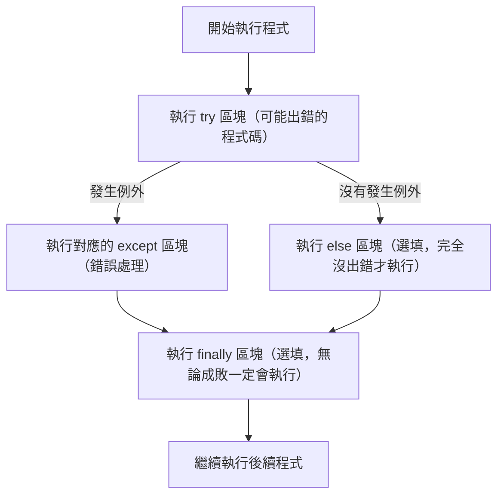

# Python 例外處理（`try ~ except`）由淺入深學習講義

> **課程代碼**：TVDI Python 20261125  
> **使用工具**：Herd（Herdr，本地環境管理工具）、Visual Studio Code（VS Code，程式碼編輯器）  
> **Python 版本**：3.10 以上（以 Windows 環境示範）  
> **學習目標**：認識程式錯誤與例外的差異，學會使用 `try ~ except ~ else ~ finally`、`raise` 與迴圈輸入防呆，寫出不會輕易閃退的 Python 程式

---

## 📋 目錄

1. [認識錯誤與例外（Error vs. Exception）](#1-認識錯誤與例外error-vs-exception)
2. [第一個 `try ~ except` 程式](#2-第一個-try--except-程式)
3. [指定例外類型與多重 `except`](#3-指定例外類型與多重-except)
4. [完整語法：`try ~ except ~ else ~ finally`](#4-完整語法try--except--else--finally)
5. [主動拋出例外：`raise`](#5-主動拋出例外raise)
6. [實戰技巧：`while` 迴圈搭配 `try ~ except` 打造輸入防呆](#6-實戰技巧while-迴圈搭配-try--except-打造輸入防呆)
7. [進階視野：例外繼承階層、避免濫用與自訂例外](#7-進階視野例外繼承階層避免濫用與自訂例外)
8. [分級課堂實戰練習](#8-分級課堂實戰練習)
9. [常見踩雷整理、重點速查表與延伸學習資源](#9-常見踩雷整理重點速查表與延伸學習資源)

---

## 1. 認識錯誤與例外（Error vs. Exception）

### 為什麼要學例外處理？

剛開始寫程式時，我們最常看到的畫面就是終端機跳出一整片**紅色錯誤訊息**，然後程式就**強制中斷（閃退）**，後面的程式碼全部來不及執行。

想像你在設計一個自動提款機程式：如果使用者不小心按錯按鍵、輸入了文字而不是數字，我們當然希望畫面提示「**請輸入正確數字**」並讓使用者重試，而不是整台機器當機重開。

在學會處理錯誤之前，我們要先分清楚 Python 中兩種常見的「紅字問題」：

| 類型 | 英文名稱 | 發生時機 | 白話解釋 | 能不能用 `try ~ except` 救援？ |
| :--- | :--- | :--- | :--- | :--- |
| **語法錯誤** | `SyntaxError` | 程式**還沒開始執行**前 | 程式碼「寫錯字」或「漏打符號」，Python 看不懂你要做什麼 | ❌ **不能**（必須先修改程式碼本身） |
| **執行期例外** | `Exception` | 程式**正在執行中** | 程式碼文法完全正確，但在執行當下遇到意外狀況（例如除以 `0`、找不到檔案） | ✅ **可以**（用 `try ~ except` 接住並妥善處理） |

---

### 1.1 語法錯誤（`SyntaxError`）示範

**步驟 1**：觀察下面這段少了冒號 `:` 的程式碼：

```python
# ❌ 錯誤示範（語法錯誤：if 結尾漏掉冒號，程式根本無法啟動）
score = 80
if score >= 60
    print("及格")
```

這類問題在按下執行的一瞬間就會失敗，必須直接把漏掉的 `:` 補回去，無法靠 `try ~ except` 處理。

---

### 1.2 執行期例外（`Exception`）示範

**步驟 2**：再看另一段語法完全正確、但執行時會發生「意外」的程式碼：

```python
# 💥 未處理例外示範（語法正確，但執行到 10 / 0 時會拋出 ZeroDivisionError 並強制中斷）
print("開始計算除法...")
result = 10 / 0  # 數學上不能除以 0，Python 會在這裡拋出例外
print("這一行永遠不會被印出來")
```

執行後終端機出現的錯誤訊息如下（稱為 **Traceback**，追蹤回溯訊息）：

```text
開始計算除法...
Traceback (most recent call last):
  File "example.py", line 3, in <module>
    result = 10 / 0
             ~~~^~~
ZeroDivisionError: division by zero
```

> [!TIP]
> **初學者讀 Traceback（錯誤追蹤訊息）的小訣竅**：請**從最下面一行往上讀**！  
> - **最後一行**：告訴你「發生什麼錯誤」（例如 `ZeroDivisionError` 除以零錯誤）以及原因。  
> - **倒數幾行**：告訴你「出錯在哪一個檔案、第幾行程式」（例如 `line 3`）。

---

## 2. 第一個 `try ~ except` 程式

### 為什麼要用 `try ~ except`？

你可以把 `try ~ except` 想成汽車裡的**「安全氣囊」**或是活動規劃時的**「雨天備案」**：

- **`try`（嘗試區塊）**：放「可能會出錯，但我們想嘗試執行」的程式碼。
- **`except`（例外處理區塊）**：當 `try` 裡面真的出錯時，程式**不會直接閃退**，而是立刻跳進 `except` 執行「備案」，處理完之後還能繼續往下跑後續程式。

### 基本語法結構

```text
try:
    # 嘗試執行的程式碼（需縮排 4 個空格）
except 例外類型:
    # 發生該例外時要執行的補救程式碼（需縮排 4 個空格）
```

---

### 對比實驗：有無 `try ~ except` 的差別

#### ❌ 沒有加上保護時（程式直接中斷）

```python
# 💥 未處理例外示範（輸入非數字文字時，int() 會拋出 ValueError 並中斷程式）
user_input = "abc"
number = int(user_input)  # 無法把 "abc" 轉成整數，程式在此閃退
print(f"您輸入的數字是：{number}")
print("程式安全結束。")  # 這行完全不會執行
```

#### ✅ 加上 `try ~ except` 保護後（程式優雅繼續）

**步驟 1**：將可能轉換失敗的 `int(user_input)` 放進 `try:` 區塊（縮排 4 個空格）。  
**步驟 2**：針對可能發生的 `ValueError`（數值錯誤，例如文字無法轉數字），寫一段 `except ValueError:` 提示訊息。  
**步驟 3**：在 VS Code 終端機執行，觀察最後一行的「程式安全結束」是否成功印出。

```python
# ✅ 正確示範：用 try ~ except 接住轉換失敗的錯誤
user_input = "abc"

try:
    number = int(user_input)  # 嘗試把文字轉成整數
    print(f"您輸入的數字是：{number}")
except ValueError:
    print("輸入格式錯誤：請輸入有效的整數，不要輸入文字或符號！")

print("程式安全結束。")  # 不論是否出錯，程式都能順利走到這裡
```

**預期輸出：**

```text
輸入格式錯誤：請輸入有效的整數，不要輸入文字或符號！
程式安全結束。
```

> [!NOTE]
> **Windows 終端機執行提醒**：在 Windows 的 PowerShell（終端機視窗）執行 Python 程式時，請輸入 `python 檔名.py`（若您的系統設定別名為 `python3` 則改用 `python3`）。

---

## 3. 指定例外類型與多重 `except`

### 為什麼要區分不同的例外類型？

同一段程式碼可能因為「不同原因」而出錯。舉例來說，做除法計算時：
- 使用者輸入 `"你好"` → 這是**格式不對**（`ValueError`）
- 使用者輸入 `"0"` 當除數 → 這是**除數為零**（`ZeroDivisionError`）

如果能針對不同錯誤給出精準提示，使用者才知道該怎麼修正。

### 初學者最常見的 6 種內建例外

| 例外名稱 | 中文意思 | 常見觸發原因 | 觸發範例 |
| :--- | :--- | :--- | :--- |
| `ValueError` | 數值錯誤 | 型別對，但內容值不合法 | `int("abc")` |
| `ZeroDivisionError` | 除以零錯誤 | 除法或取餘數時除數為 `0` | `10 / 0` 或 `10 % 0` |
| `TypeError` | 型別錯誤 | 不同資料型別無法一起運算 | `"分數：" + 90` |
| `IndexError` | 索引超出範圍錯誤 | 讀取串列（`list`）不存在的位置 | `[10, 20][5]` |
| `KeyError` | 鍵值不存在錯誤 | 讀取字典（`dict`）不存在的鍵（Key） | `{"name": "小明"}["age"]` |
| `FileNotFoundError` | 找不到檔案錯誤 | 開啟路徑不存在的檔案 | `open("missing.txt", "r")` |

---

### 3.1 多個 `except` 分別處理不同錯誤

**目的**：讓函式能分辨「輸入非數字」與「除數為零」，顯示對應的提示。  
**方法**：在同一個 `try:` 下方依序接上多個 `except`，Python 會自動挑選**第一個符合**的例外來執行：

```python
def divide_texts(numerator_text, denominator_text):
    """
    將兩個文字轉為整數後相除，並針對不同錯誤給予精準提示

    參數：
        numerator_text (str): 被除數的文字
        denominator_text (str): 除數的文字
    """
    try:
        numerator = int(numerator_text)      # 可能引發 ValueError
        denominator = int(denominator_text)  # 可能引發 ValueError
        result = numerator / denominator     # 可能引發 ZeroDivisionError
        print(f"計算結果：{numerator} / {denominator} = {result}")
    except ValueError:
        print("錯誤提示：輸入內容必須是整數文字，例如 '10' 或 '2'。")
    except ZeroDivisionError:
        print("錯誤提示：除數不可以是 0，請換一個數字。")


# 依序測試三種情況
divide_texts("10", "2")    # 正常執行
divide_texts("十", "2")    # 觸發 ValueError
divide_texts("10", "0")    # 觸發 ZeroDivisionError
```

**預期輸出：**

```text
計算結果：10 / 2 = 5.0
錯誤提示：輸入內容必須是整數文字，例如 '10' 或 '2'。
錯誤提示：除數不可以是 0，請換一個數字。
```

---

### 3.2 合併捕捉多種例外

**目的**：如果兩種錯誤你想用「同一種方式」處理，不需要重複寫兩段一模一樣的程式碼。  
**方法**：用小括號 `(...)`（元組 `tuple`）把多個例外名稱包起來寫在同一個 `except` 後面：

```python
def parse_and_divide(first_text, second_text):
    """
    合併捕捉 ValueError 與 ZeroDivisionError，統一回傳 None

    參數：
        first_text (str): 被除數文字
        second_text (str): 除數文字

    回傳：
        float | None: 成功回傳商，失敗回傳 None
    """
    try:
        result = int(first_text) / int(second_text)
        return result
    except (ValueError, ZeroDivisionError):
        print("計算失敗：請確認輸入為有效整數，且除數不可為 0。")
        return None


print(parse_and_divide("12", "3"))   # 輸出：4.0
print(parse_and_divide("12", "0"))   # 提示錯誤並輸出：None
print(parse_and_divide("abc", "3"))  # 提示錯誤並輸出：None
```

---

### 3.3 使用 `as error` 取得錯誤詳細原因

**目的**：除了我們自己寫的提示，有時也想印出 Python 原本提供的錯誤原因，方便查錯或記錄日誌。  
**方法**：在例外名稱後面加上 `as 變數名稱`（通常取名為 `error` 或 `err`）：

```python
student_scores = {"小明": 90, "小華": 85}
target_name = "小美"

try:
    score = student_scores[target_name]
    print(f"{target_name} 的分數是 {score}")
except KeyError as error:
    # error 裡面保存了觸發錯誤的那個不存在的鍵
    print(f"查無此學生資料，找不到的鍵為：{error}")
```

**預期輸出：**

```text
查無此學生資料，找不到的鍵為：'小美'
```

---

## 4. 完整語法：`try ~ except ~ else ~ finally`

### 為什麼還需要 `else` 和 `finally`？

隨著程式變複雜，你會遇到兩種常見需求：
1. **只想把「真正可能出錯的那一兩行」放進 `try`**，其他「確定沒出錯後才要繼續做的事」想另外分開寫 → 使用 **`else`**。
2. 有些善後動作（例如關閉連線、印出結束標記），**不管剛剛成功還是失敗，都一定要執行** → 使用 **`finally`**。

### 執行流程圖



### 四大區塊執行時機對照表

| 區塊名稱 | 英文原意 | 何時會執行？ | 常見用途 |
| :--- | :--- | :--- | :--- |
| `try` | 嘗試 | **永遠**先執行 | 包住最可能出錯的核心程式 |
| `except` | 例外（除了） | 只有 `try` **發生對應例外**時才執行 | 顯示提示、寫入錯誤紀錄、提供備用值 |
| `else` | 否則（沒事的話） | 只有 `try` **完全沒有發生例外**時才執行 | 處理成功後的後續運算，避免 `try` 區塊過於肥大 |
| `finally` | 最後（無論如何） | **永遠最後執行**（不管有沒有出錯，甚至 `try` 裡先 `return` 也會執行） | 釋放資源、清理暫存、印出結束分隔線 |

---

### 4.1 四段完整範例：除法與流程觀察

```python
def run_division_demo(a_text, b_text):
    """
    展示 try / except / else / finally 四個區塊的執行順序

    參數：
        a_text (str): 被除數文字
        b_text (str): 除數文字
    """
    print(f"--- 開始測試輸入：'{a_text}' 與 '{b_text}' ---")
    try:
        a = int(a_text)
        b = int(b_text)
        result = a / b
    except ValueError:
        print("[except] 格式錯誤：請輸入整數。")
    except ZeroDivisionError:
        print("[except] 數學錯誤：除數不能為 0。")
    else:
        # 只有 try 裡完全沒出錯，才會執行 else
        print(f"[else] 計算成功！{a} / {b} = {result}")
    finally:
        # 不論成功或失敗，最後一定都會執行 finally
        print("[finally] 本次測試流程結束。\n")


run_division_demo("10", "2")    # 走 try -> else -> finally
run_division_demo("abc", "2")   # 走 try -> except(ValueError) -> finally
run_division_demo("10", "0")    # 走 try -> except(ZeroDivisionError) -> finally
```

**預期輸出：**

```text
--- 開始測試輸入：'10' 與 '2' ---
[else] 計算成功！10 / 2 = 5.0
[finally] 本次測試流程結束。

--- 開始測試輸入：'abc' 與 '2' ---
[except] 格式錯誤：請輸入整數。
[finally] 本次測試流程結束。

--- 開始測試輸入：'10' 與 '0' ---
[except] 數學錯誤：除數不能為 0。
[finally] 本次測試流程結束。
```

---

### 4.2 銜接先前課程：安全讀取文字檔

記得之前在檔案操作課程學過的 `with open(..., encoding="utf-8")` 嗎？如果檔名打錯，程式就會拋出 `FileNotFoundError`（找不到檔案錯誤）。搭配 `try ~ except ~ else ~ finally` 可以寫出更穩固的讀檔程式：

```python
def read_text_safely(file_path):
    """
    安全讀取文字檔內容，若檔案不存在則給予提示

    參數：
        file_path (str): 要讀取的檔案路徑
    """
    try:
        with open(file_path, "r", encoding="utf-8") as file:
            content = file.read()
    except FileNotFoundError:
        print(f"找不到檔案：{file_path}，請確認檔名與路徑是否正確。")
    except UnicodeDecodeError:
        print(f"檔案編碼錯誤：{file_path} 不是 UTF-8 文字格式。")
    else:
        print(f"成功讀取 {file_path}，共有 {len(content)} 個字元。")
        print(content)
    finally:
        print("檔案讀取檢查完成。")


# 測試讀取不存在的檔案
read_text_safely("not_exist_note.txt")
```

---

## 5. 主動拋出例外：`raise`

### 為什麼有時候需要「自己製造錯誤」？

前面學的都是「Python 主動報錯，我們用 `except` 接住」。但有時候**程式語法跟數學都合法，卻不符合我們的業務規則**。

例如：
- 考試分數只能是 `0` 到 `100` 分，如果有人輸入 `-10` 或 `150`，Python 不會主動報錯（因為它們都是合法整數）。
- 某個共用的函式規定「價格不可為負數」或「除數不可為零」且要統一回報中文錯誤訊息。

這時候我們就可以用 **`raise`**（拋出）關鍵字，主動通知呼叫這個函式的人：「傳進來的資料不合理，我拒絕繼續往下算！」

---

### 5.1 基本 `raise ValueError` 範例

```python
def check_exam_score(score):
    """
    檢查考試成績是否在 0 到 100 的合理範圍內

    參數：
        score (int | float): 學生分數

    回傳：
        str: 成績等第說明

    例外：
        ValueError: 當分數小於 0 或大於 100 時主動拋出
    """
    if score < 0 or score > 100:
        raise ValueError(f"成績必須介於 0 到 100 之間，目前收到：{score}")
    if score >= 60:
        return "及格"
    return "不及格"


for test_score in [85, -5, 105]:
    try:
        status = check_exam_score(test_score)
        print(f"分數 {test_score} -> {status}")
    except ValueError as error:
        print(f"資料驗證失敗：{error}")
```

**預期輸出：**

```text
分數 85 -> 及格
資料驗證失敗：成績必須介於 0 到 100 之間，目前收到：-5
資料驗證失敗：成績必須介於 0 到 100 之間，目前收到：105
```

---

### 5.2 實戰銜接：串接本資料夾的 `calc.py`

在同一個資料夾（`tvdi_python_20261125`）裡，我們已經建立了一個模組 [calc.py](./calc.py)，裡面的 `divide(a, b)` 正是利用 `raise` 來規範除數：

```python
# calc.py 的核心設計（供對照參考）
def divide(a, b):
    if b == 0:
        raise ValueError("除數不可為零")
    return a / b
```

> [!IMPORTANT]
> **良好程式設計的「職責分工」**：  
> - **工具函式（如 `calc.py` 的 `divide`）**：負責把規則檢查清楚，遇到不合理的值就用 `raise` 拋出例外，**不要**在函式裡面自己印出錯誤就草率回傳 `0`。  
> - **呼叫端程式（如下方的 `safe_divide`）**：使用 `try ~ except` 接住例外，決定要印出中文提示、要求使用者重輸，還是記錄日誌。

現在我們在主程式中匯入 `calc.py` 的 `divide`，並用 `try ~ except` 包裝它：

```python
from calc import divide  # 匯入同資料夾的 calc.py 除法函式


def safe_divide(numerator, denominator):
    """
    安全執行兩數相除，當除數為 0 時捕捉 ValueError 並回傳 None

    參數：
        numerator (int | float): 被除數
        denominator (int | float): 除數

    回傳：
        float | None: 成功時回傳商；發生錯誤時回傳 None
    """
    try:
        result = divide(numerator, denominator)  # 呼叫可能拋出 ValueError 的函式
    except ValueError as error:
        print(f"計算失敗：{error}")  # 印出 calc.py 拋出的中文錯誤訊息
        return None
    else:
        print(f"計算成功：{numerator} / {denominator} = {result}")
        return result
    finally:
        print("本次除法運算流程結束。")


safe_divide(10, 2)
safe_divide(10, 0)
```

**預期輸出：**

```text
計算成功：10 / 2 = 5.0
本次除法運算流程結束。
計算失敗：除數不可為零
本次除法運算流程結束。
```

---

## 6. 實戰技巧：`while` 迴圈搭配 `try ~ except` 打造輸入防呆

### 為什麼需要搭配 `while` 迴圈？

單純使用一次 `try ~ except`，雖然不會閃退，但使用者輸錯一次後程式就結束了。  
實務上更常見的需求是：**「只要輸入格式不對，就提醒他並讓他重新輸入，直到輸入正確為止」**。

### 步驟設計

1. 用 `while True:` 建立一個持續重複詢問的迴圈。
2. 在迴圈裡面放入 `try:`，嘗試讀取 `input()` 並用 `int()` 轉換成整數。
3. 若需要額外條件（例如除數不能為 `0`），在同一個 `try:` 裡檢查並主動 `raise ValueError(...)`。
4. 如果這輪完全沒出錯，執行 **`break`**（跳出迴圈）並 `return` 合法的數字。
5. 如果發生 `ValueError`，進到 `except` 印出提示後，迴圈會自動重跑下一輪讓使用者再輸入一次。

```python
def get_valid_integer(prompt_text, allow_zero=True):
    """
    重複詢問使用者直到輸入合法整數為止

    參數：
        prompt_text (str): 顯示給使用者的提示文字
        allow_zero (bool): 是否允許輸入 0，預設為 True

    回傳：
        int: 驗證通過的整數
    """
    while True:
        raw_text = input(prompt_text)
        try:
            value = int(raw_text)
            if not allow_zero and value == 0:
                raise ValueError("此欄位不可輸入 0")
        except ValueError as error:
            print(f"輸入無效（{error}），請再試一次！")
        else:
            return value  # 成功轉換且符合規則，直接回傳並結束迴圈


# 示範互動流程（將這段存成 .py 檔並在終端機執行即可互動測試）
if __name__ == "__main__":
    first_number = get_valid_integer("請輸入被除數（整數）：")
    second_number = get_valid_integer("請輸入除數（非 0 整數）：", allow_zero=False)
    print(f"結果：{first_number} / {second_number} = {first_number / second_number}")
```

**模擬終端機互動畫面：**

```text
請輸入被除數（整數）：abc
輸入無效（invalid literal for int() with base 10: 'abc'），請再試一次！
請輸入被除數（整數）：20
請輸入除數（非 0 整數）：0
輸入無效（此欄位不可輸入 0），請再試一次！
請輸入除數（非 0 整數）：4
結果：20 / 4 = 5.0
```

---

## 7. 進階視野：例外繼承階層、避免濫用與自訂例外

當你越寫越多程式，需要開始注意例外處理的「好習慣」與「陷阱」。

### 7.1 避免濫用：不要寫空的「裸 `except:`」

初學者最容易犯的習慣，就是寫一個不指定類型的 `except:` 把所有錯誤全吞掉，這樣反而會讓自己找不到 Bug（程式錯誤）：

| 寫法 | 行為說明 | 潛在風險與建議 |
| :--- | :--- | :--- |
| **裸 `except:`**（不建議） | 攔截**所有東西**，包含使用者按 `Ctrl + C` 想中斷程式時觸發的 `KeyboardInterrupt`（鍵盤中斷） | ❌ **極不建議**：連變數拼錯（`NameError`）都會被掩蓋，甚至關不掉無窮迴圈 |
| **指定 `except ValueError:`**（最推薦） | 只接住我們**預期可能會發生**的錯誤類型 | ✅ **最推薦**：其他意料之外的程式 Bug 會照常跳出紅字，方便第一時間修正 |
| **`except Exception as error:`**（謹慎使用） | 接住一般執行期例外（不會攔截 `Ctrl + C`），但仍會包含 `NameError`、`TypeError` | ⚠️ 僅建議放在最外層記錄錯誤日誌（Logging），且一定要印出 `error` 內容 |

觀察下面這個對比，看看「捉得太寬」會發生什麼事：

```python
# ❌ 錯誤示範：使用 except Exception 把程式寫錯的 NameError 也掩蓋掉了
try:
    price = int("100")
    print(prcie)  # 故意拼錯變數名稱：price 打成 prcie（應為 NameError）
except Exception:
    print("輸入的不是數字！")  # 誤導使用者！其實是工程師自己拼錯字
```

如果只寫 `except ValueError:`，一旦發生變數拼錯，Python 就會立刻在終端機顯示 `NameError: name 'prcie' is not defined`，馬上就能抓出拼字錯誤。

---

### 7.2 例外繼承階層與 `except` 排列順序

在 Python 裡，例外之間其實有「家族（繼承）」關係，就像生物分類一樣：

```text
BaseException（最頂層基底，包含系統結束與 Ctrl+C）
 └── Exception（所有一般程式例外的共同祖先）
      ├── ValueError（數值錯誤）
      ├── TypeError（型別錯誤）
      ├── LookupError（查詢錯誤）
      │    ├── IndexError（索引錯誤）
      │    └── KeyError（鍵值錯誤）
      ├── OSError（系統與檔案錯誤）
      │    └── FileNotFoundError（找不到檔案）
      └── ArithmeticError（算術錯誤）
           └── ZeroDivisionError（除以零錯誤）
```

> [!WARNING]
> **排列順序鐵則：先寫「小範圍（具體）」的例外，最後才寫「大範圍（廣泛）」的例外！**  
> 如果把 `except Exception:` 放在最上面，所有例外都會被它提前搶走，後面的 `except ZeroDivisionError:` 就永遠輪不到執行了。

```python
# ❌ 錯誤順序示範：把大範圍的 Exception 放在最上面
try:
    result = 10 / 0
except Exception:
    print("發生一般錯誤（把 ZeroDivisionError 搶走了！）")
except ZeroDivisionError:
    print("這一行永遠不會被執行到！")
```

```python
# ✅ 正確順序示範：具體例外放前面，廣泛例外放最後
try:
    result = 10 / 0
except ZeroDivisionError:
    print("捕捉到特定錯誤：除數不可為 0！")
except Exception as error:
    print(f"捕捉到其他未預期的錯誤：{error}")
```

---

### 7.3 進階預告：自訂例外（Custom Exception）

在大型專案中，我們有時會替自己寫的程式設計一個專屬名稱的例外（例如「分數超出範圍錯誤」），讓程式碼讀起來像英文句子一樣好懂：

> [!NOTE]
> **課程進度提醒**：下方的 `class`（類別）與「繼承（Inheritance）」屬於物件導向程式設計的主題，**這個主題會在後續課程中深入介紹**。現在只需要先看懂「我們可以自己替特定錯誤取一個專屬名稱」即可。

```python
class ScoreOutOfRangeError(Exception):
    """自訂例外：當分數不在 0 到 100 之間時拋出"""
    pass


def register_score(student_name, score):
    """
    登錄學生成績，若超出範圍則拋出自訂例外

    參數：
        student_name (str): 學生姓名
        score (int | float): 成績（0 ~ 100）
    """
    if score < 0 or score > 100:
        raise ScoreOutOfRangeError(f"{student_name} 的成績 {score} 超出 0~100 合理範圍")
    print(f"已登錄 {student_name} 的成績：{score}")


try:
    register_score("小明", 95)
    register_score("小華", 120)
except ScoreOutOfRangeError as error:
    print(f"成績登錄失敗：{error}")
```

**預期輸出：**

```text
已登錄 小明 的成績：95
成績登錄失敗：小華 的成績 120 超出 0~100 合理範圍
```

---

## 8. 分級課堂實戰練習

建議先自己動手寫寫看，再展開參考解答對照做法！

### 🏋️ 練習一（基礎）：安全索引查詢器

**目標**：寫一個函式 `get_item_safely(items, index_text)`，接收一個串列（`list`）與一個文字型態的索引值（例如 `"0"`、`"abc"`、`"99"`）：
- 若 `index_text` 無法轉成整數（`ValueError`），印出「索引必須是整數」並回傳 `None`。
- 若索引超出串列範圍（`IndexError`），印出「索引超出範圍」並回傳 `None`。
- 成功時回傳該位置的項目。

<details>
<summary>點擊查看練習一參考解答</summary>

```python
def get_item_safely(items, index_text):
    """
    安全取得串列指定位置的項目，避免格式錯誤或索引超界

    參數：
        items (list): 資料串列
        index_text (str): 代表索引位置的文字

    回傳：
        Any | None: 找到的項目，若發生錯誤則回傳 None
    """
    try:
        index = int(index_text)  # 可能引發 ValueError
        return items[index]      # 可能引發 IndexError
    except ValueError:
        print("查詢失敗：索引必須是整數。")
        return None
    except IndexError:
        print(f"查詢失敗：索引 {index_text} 超出範圍（有效範圍 0 ~ {len(items) - 1}）。")
        return None


fruits = ["蘋果", "香蕉", "橘子"]
print(get_item_safely(fruits, "1"))     # 香蕉
print(get_item_safely(fruits, "abc"))   # 查詢失敗... None
print(get_item_safely(fruits, "10"))    # 查詢失敗... None
```

</details>

---

### 🏋️ 練習二（進階）：串接 `calc.py` 的防呆計算機

**目標**：在 `tvdi_python_20261125` 資料夾中新增一支練習檔，匯入 [calc.py](./calc.py) 的 `divide(a, b)`：
1. 使用 `while True` 持續向使用者詢問「被除數」與「除數」（允許輸入小數 `float`）。
2. 若輸入 `"q"` 則結束程式。
3. 使用 `try ~ except ValueError` 同時處理「輸入非數字」與 `divide()` 拋出的 `"除數不可為零"` 錯誤，失敗時提示訊息並重新詢問，成功時印出計算結果。

<details>
<summary>點擊查看練習二參考解答</summary>

```python
from calc import divide  # 匯入同資料夾的 calc.py 除法函式


def run_interactive_calculator():
    """
    互動式安全除法計算機，輸入 'q' 可隨時離開
    """
    print("=== 歡迎使用安全除法計算機（輸入 q 離開） ===")
    while True:
        first_text = input("請輸入被除數（或輸入 q 離開）：").strip()
        if first_text.lower() == "q":
            print("感謝使用，再見！")
            break

        second_text = input("請輸入除數（或輸入 q 離開）：").strip()
        if second_text.lower() == "q":
            print("感謝使用，再見！")
            break

        try:
            a = float(first_text)   # 若不是數字會拋出 ValueError
            b = float(second_text)  # 若不是數字會拋出 ValueError
            result = divide(a, b)   # 若 b 為 0 會拋出 ValueError("除數不可為零")
        except ValueError as error:
            print(f"計算失敗（{error}），請重新輸入！\n")
        else:
            print(f"計算結果：{a} / {b} = {result}\n")


if __name__ == "__main__":
    run_interactive_calculator()
```

</details>

---

### 🏋️ 練習三（挑戰）：安全讀取檔案並計算平均分數

**目標**：寫一個函式 `calculate_average_from_file(file_path)`，從文字檔讀取每一行的分數並計算平均：
1. 若檔案不存在，捕捉 `FileNotFoundError` 並印出提示。
2. 檔案內可能有空白行，也可能不小心混入非數字文字（例如 `"缺考"`）：請跳過空白行，並在遇到非數字時透過 `try ~ except ValueError` 印出警告但不中斷讀取其餘行。
3. 若檔案內完全沒有任何有效分數（總數為 `0`），在計算平均值時處理 `ZeroDivisionError`。

<details>
<summary>點擊查看練習三參考解答（可直接執行）</summary>

```python
from pathlib import Path


def calculate_average_from_file(file_path):
    """
    從文字檔讀取成績並計算平均值，安全處理缺檔、壞資料與無有效成績的情況

    參數：
        file_path (str | Path): 分數文字檔路徑

    回傳：
        float | None: 計算出的平均分數（四捨五入至小數點後兩位）；失敗時回傳 None
    """
    valid_scores = []

    try:
        with open(file_path, "r", encoding="utf-8") as file:
            for line_number, raw_line in enumerate(file, start=1):
                cleaned_text = raw_line.strip()
                if not cleaned_text:
                    continue  # 跳過空白行

                try:
                    score = float(cleaned_text)
                    valid_scores.append(score)
                except ValueError:
                    print(f"第 {line_number} 行資料 '{cleaned_text}' 不是有效數字，已略過。")
    except FileNotFoundError:
        print(f"找不到檔案：{file_path}")
        return None

    try:
        average = sum(valid_scores) / len(valid_scores)
    except ZeroDivisionError:
        print("檔案中沒有任何有效分數，無法計算平均。")
        return None
    else:
        return round(average, 2)


# --- 以下為自動建立測試檔案與清理的示範程式 ---
demo_file = Path("demo_scores_temp.txt")
try:
    # 先測試不存在的檔案
    print("測試 1（缺檔）：", calculate_average_from_file("missing_scores.txt"))

    # 建立含空白行與壞資料的測試檔案
    demo_file.write_text("80\n\n缺考\n90\n85\n", encoding="utf-8")
    print("測試 2（含壞資料）：平均 =", calculate_average_from_file(demo_file))

    # 建立僅含無效資料的測試檔案
    demo_file.write_text("無成績\n", encoding="utf-8")
    print("測試 3（零筆有效分數）：", calculate_average_from_file(demo_file))
finally:
    if demo_file.exists():
        demo_file.unlink()  # 測試完成後移除暫存檔案，保持資料夾整潔
```

</details>

---

## 9. 常見踩雷整理、重點速查表與延伸學習資源

### ⚠️ 初學者常見踩雷整理

| 錯誤狀況 | 常見原因 | 解決方式 |
| :--- | :--- | :--- |
| `IndentationError`（縮排錯誤） | `try:`、`except:` 底下沒有縮排，或混用 Tab 鍵與空格 | 統一使用 **4 個空格**縮排 |
| `SyntaxError`（語法錯誤） | `try`、`except`、`else`、`finally` 行尾忘記加冒號 `:` | 在關鍵字該行結尾補上 `:` |
| `except` 順序放反 | 把 `except Exception:` 放在特定例外（如 `ValueError`）前面 | 先寫小範圍特定例外，再寫大範圍 `Exception` |
| 使用裸 `except:` | 只寫 `except:` 沒寫例外類型 | 務必寫出具體例外類型，例如 `except ValueError:` |
| `try` 區塊包太肥 | 把幾十行不相關的程式全塞進 `try:`，導致出錯不知道哪一行出問題 | 只把「真的會出錯的那幾行」放進 `try:`，其餘放 `else:` |

---

### 📌 學習重點總結（速查卡片）

```text
1. try:                 → 放入可能發生例外的程式碼
2. except 例外類型:      → 發生該例外時的應變處理（可用 as error 拿訊息）
3. else:                → try 完全沒出錯時才執行（選填）
4. finally:             → 無論成敗一定會執行的收尾動作（選填）
5. raise 例外("訊息")    → 違反規則時主動拋出例外通知呼叫端
6. while True + try     → 製作輸入防呆的最佳組合
```

---

### 🔗 延伸學習資源

- [Python 官方繁體中文文件 — 錯誤與例外（Errors and Exceptions）](https://docs.python.org/zh-tw/3/tutorial/errors.html)
- [Python 官方繁體中文文件 — 內建例外一覽（Built-in Exceptions）](https://docs.python.org/zh-tw/3/library/exceptions.html)

---

> 📝 **講義版本**：v1.0 ｜ **日期**：2026-11-25  
> 本講義為 TVDI Python 課程教材，搭配 [calc.py](./calc.py) 與 [test_calc.py](./tests/test_calc.py) 使用。
